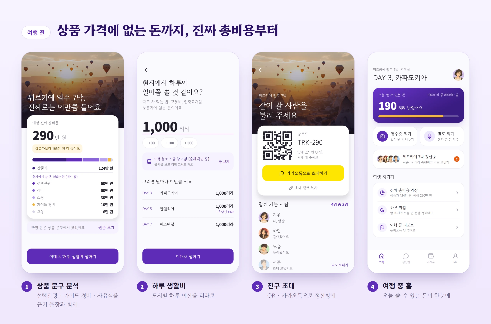
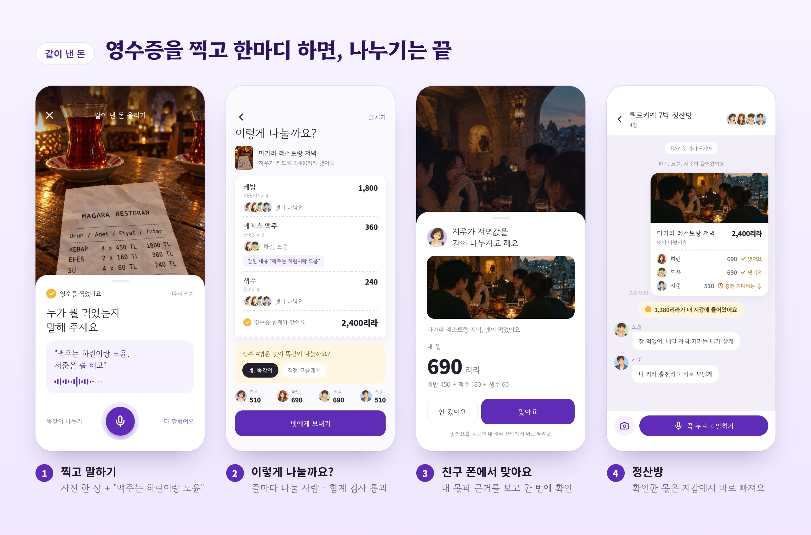
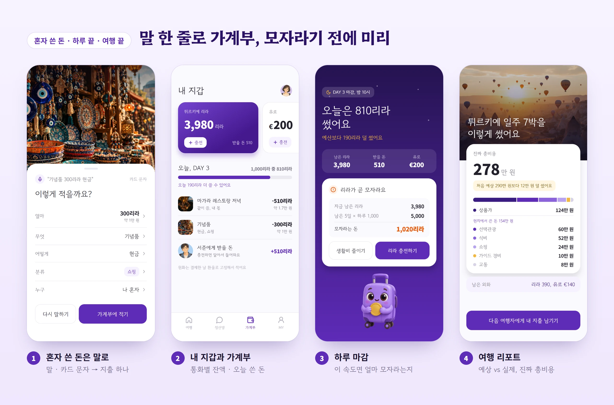
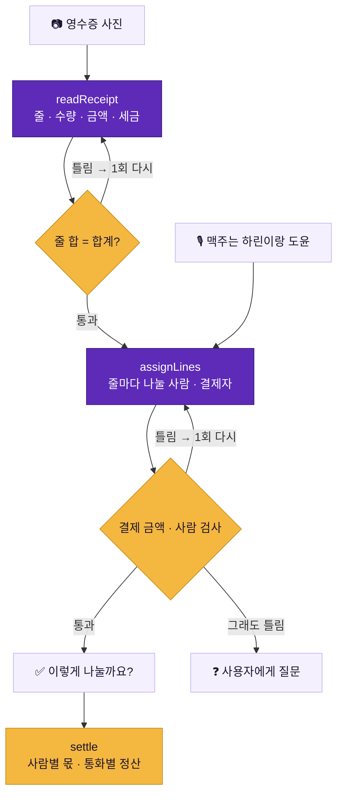
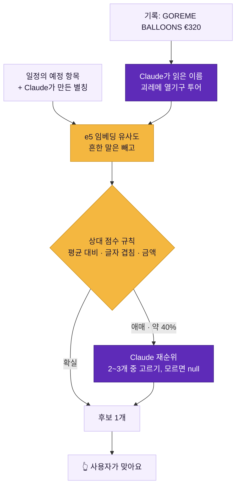
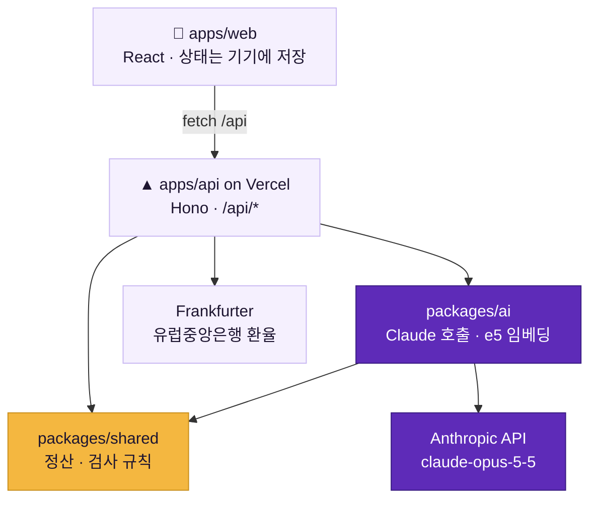

<div align="center">


<br />

**영수증을 찍고, 한마디 하면, 친구는 확인만.**<br />
여행 중 같이 쓴 돈을 줄 단위로 나누고, 혼자 쓴 돈은 말 한 줄로 가계부에 적는 앱

<br />

[](https://hanatour-290-app.vercel.app)


<sub>2026 SVC Seoul AI 해커톤 · 하나투어 트랙 · 팀 290</sub>

</div>

<br />

## 목차

- [왜 만들었나](#왜-만들었나)
- [시연 흐름](#시연-흐름)
- [핵심 원칙: 읽는 건 AI, 계산은 규칙](#핵심-원칙-읽는-건-ai-계산은-규칙)
- [AI가 하는 일](#ai가-하는-일)
- [측정 결과](#측정-결과)
- [구조](#구조)
- [시작하기](#시작하기)
- [API 한눈에 보기](#api-한눈에-보기)
- [배포와 운영](#배포와-운영)
- [협업 규칙과 문서](#협업-규칙과-문서)

<br />

## 왜 만들었나

패키지 여행에서 돈 문제는 두 번 생깁니다.

| 언제 | 생기는 일 | 트립버짓이 하는 일 |
| --- | --- | --- |
| **떠나기 전** | 상품가만 보고 예산을 잡지만, 선택관광 · 가이드 경비 · 자유식처럼 가격표에 없는 돈이 따로 나간다 | 상품 문구를 읽어 따로 내는 돈을 **근거 문장과 함께** 찾아 진짜 총비용을 보여 준다 |
| **여행 중** | 저녁 한 번에도 "맥주는 둘만, 생수는 넷이"처럼 나누는 방식이 줄마다 다르다. 통화도 여러 개 | 영수증 사진 + 한마디로 **줄마다 나눌 사람**을 정하고, 몫 계산은 서버 규칙이 한다 |
| **여행 끝** | 결국 얼마 썼는지, 처음 예상과 얼마나 달랐는지 모른다 | 예상 vs 실제를 통화별 · 분류별로 정리한 리포트 |

<br />

## 시연 흐름

> 튀르키예 일주 7박 · 4명(지우 · 하린 · 도윤 · 서준) · 상품가 124만 원.
> 아래 화면은 모두 [시연 사이트](https://hanatour-290-app.vercel.app)를 휴대폰 크기로 캡처한 것입니다.







<details>
<summary><b>전체 16개 화면 목록</b> (주소 뒤에 <code>?step=번호</code> 를 붙이면 그 화면으로 바로 갑니다)</summary>

<br />

| 번호 | 화면 | 누구 폰 | 하는 일 |
| :---: | --- | :---: | --- |
| `0` | 스플래시 | 지우 | |
| `0-1` | 상품 불러오기 | 지우 | 하나투어 상품 링크 · 문구 붙여 넣기 |
| `0-2` | 진짜 총비용 예상 | 지우 | 상품가 + 현지에서 쓸 돈 (예시: 124만 원 → 290만 원) |
| `3` | 하루 생활비 정하기 | 지우 | 도시별 하루 예산 |
| `1` | 친구 초대하기 | 지우 | QR · 카카오톡 · 링크 |
| `2` | 이름 고르기 | 하린 | 초대받은 사람이 자기 이름 선택 |
| `home` | 홈 | 지우 | 오늘 쓸 수 있는 돈, 바로가기 |
| `4` | 찍고 말하기 | 지우 | 영수증 사진 + 한마디 → AI 분석 |
| `5` | 이렇게 나눌까요? | 지우 | 줄마다 나눌 사람, 합계 검사, 사람별 몫 |
| `6` | 맞아요 누르기 | 하린 | 내 몫과 근거 확인 |
| `7` | 정산방 | 지우 | 확인 상태, 지갑에 들어온 돈 |
| `8` | 모자라면 충전 | 서준 | 잔액이 모자랄 때 충전 금액 고르기 |
| `9` | 혼자 쓴 돈은 말로 | 지우 | 말 · 카드 문자 → 지출 하나, 일정의 예정 지출과 연결 |
| `10` | 내 지갑과 가계부 | 지우 | 통화별 잔액, 오늘 쓴 돈 |
| `11` | 하루 마감 | 지우 | 이 속도면 얼마 모자라는지 |
| `12` | 여행 리포트 | 지우 | 예상 vs 실제 진짜 총비용 |

</details>

<br />

## 핵심 원칙: 읽는 건 AI, 계산은 규칙

AI는 **사진과 말을 읽어 구조화된 값으로 바꾸는 일**만 합니다. 나누기 · 환산 · 차감 · 검사는 모두 `packages/shared`의 순수 함수가 하고, 같은 입력이면 늘 같은 답이 나옵니다. AI가 읽은 값이 규칙 검사에 걸리면 틀린 점을 알려 주고 **한 번만** 다시 읽게 하고, 그래도 안 맞으면 사람에게 묻습니다.



<sub>보라색 = Claude, 노란색 = 서버 규칙, 연한 색 = 입력 · 결과. 코드: `packages/ai/src/pipeline.js`, `validate.js`, `packages/shared/src/settle.js`</sub>

<br />

## AI가 하는 일

| 기능 | 입력 → 출력 | 코드 | 요구사항 |
| --- | --- | --- | :---: |
| **진짜 총비용** | 상품 문구 → 따로 내는 돈 항목 + 근거 원문 + 환율 | `packages/ai/src/estimate.js` | FR-001 |
| **영수증 읽기** | 사진 → 메뉴 · 수량 · 금액 · 세금 줄, 현지어 메뉴 번역 | `readReceipt.js` | FR-007 |
| **말로 나누기** | 줄 목록 + 한마디 → 줄마다 나눌 사람, 결제자 여러 명 | `assign.js`, `payers.js` | FR-008 |
| **검사 후 다시 읽기** | 서버가 찾은 틀린 점 → 1회 재시도, 그래도 틀리면 질문 | `pipeline.js`, `validate.js` | FR-009 |
| **말 · 카드 문자 기록** | "케밥 600리라 내가 냈어" / 승인 · 취소 문자 → 지출 하나 + 분류 | `record.js` | FR-015 · 016 · 018 |
| **예정 지출 연결** | 기록 ↔ 일정의 예정 항목(선택관광 등) 후보 찾기 → 사용자가 "맞아요" | `embed.js`, `planMatch.js`, `rerank.js` | 추천 2 |

### 쓰는 모델과 설정

| 항목 | 값 |
| --- | --- |
| 생성 모델 | `claude-opus-5-5` (`.env`의 `AI_MODEL`로 바꿈, 코드 수정 없음) |
| 결과 형식 | 구조화 출력 — zod 스키마로 고정 (`client.beta.messages.parse` + `betaZodOutputFormat`) |
| 추론 강도 | `effort: low` |
| 거절 대비 | `fallbacks: "default"` — 모델이 거절하면 서버가 다른 모델로 한 번 더 |
| 임베딩 모델 | `Xenova/multilingual-e5-small` (ONNX · 8비트 · 384차원), 서버 안에서 실행, API 비용 없음 |
| 요청 수 제한 | Claude를 부르는 API는 기기당 분당 30회, 나머지는 분당 300회 (`apps/api/src/lib/rateLimit.js`) |

### 예정 지출 연결은 어떻게 동작하나



- 이 모델은 관계없는 항목끼리도 유사도가 0.77 안팎이라, 고정 문턱 대신 **같은 상품 항목 평균보다 얼마나 높은가**를 봅니다 (항목 5개 이상일 때).
- 여러 문장을 한 번에 넣으면 길이 맞춤 때문에 값이 최대 0.003 흔들려서, 문장을 하나씩 계산하고 최근 3,000개를 기억합니다.
- 연결은 언제나 **후보**일 뿐이고, 사용자가 눌러야 기록됩니다.

자세한 근거는 [docs/모델선정.md](docs/모델선정.md)에 있습니다.

<br />

## 측정 결과

### 예정 지출 연결 — 105건, 상품 5개, 통화 6종

직접 만든 예시 데이터입니다 (튀르키예 · 다낭 · 이탈리아·스위스 · 홋카이도 · 몽골, 연결 없음 36건 포함). 처음 보는 상품에서의 성능을 보려고 **상품 하나씩 빼고 값을 정하는 교차검증**으로 쟀습니다.

| 방식 | 정답률 | 잘못 연결 |
| --- | ---: | ---: |
| 이전 (절대 점수) | 83% (87/105) | 3건 |
| 규칙: 상대 점수 + 글자 겹침 | **89%** (93/105) | **0건** |
| + Claude 재순위 (애매한 것만) | **96~97%** (101~102/105) | **0건** |

<sub>`npm run eval:match -- --cv --rerank` · 2026-11-05 · 남은 오류는 모두 "못 찾음"이고 잘못 이어 붙인 것은 없습니다</sub>

### 영수증 읽기 + 말로 나누기

| 세트 | 줄 금액 일치 | 합계 일치 | 배정 정답 | 평균 시간 |
| --- | ---: | ---: | ---: | ---: |
| 평가 영수증 1장 (`packages/ai/eval/cases/001`) | 100% | 100% | 100% | 7.6초 |

<sub>`npm run eval` · 2026-11-04 · 아직 1장이라 정확도를 일반화할 수 없습니다. 요구사항 목표는 영수증 10장 × 말 2개입니다</sub>

### 운영 서버 응답 시간 (2026-11-05)

| API | 시간 |
| --- | ---: |
| 영수증 사진 + 한마디 분석 | 7.1초 |
| 말 · 카드 문자 → 지출 | 2.2~2.7초 |
| 예정 지출 연결 (규칙으로 끝날 때 / Claude 재순위) | 0.4초 / 1.9초 |
| 정산 · 환율 | 0.3~1.1초 |
| 임베딩 모델 첫 로드 (새 서버) | 약 6초 |

<sub>새 서버의 첫 로드는 앱을 열 때 `GET /api/match/warm` 으로 미리 해 두어, 보통은 사용자가 기다리지 않습니다</sub>

<br />

## 구조

| 폴더 | 내용 | 담당 브랜치 |
| --- | --- | :---: |
| `apps/web` | React 19 + Vite 8 · v5 Figma 화면 16개. `screens/` 화면 하나 = 파일 하나, `api.js` 서버 호출, `dinner.js` 영수증 결과 → 화면 모양, `format.js` 금액 · 분류 표기 | `feat/fe` |
| `apps/api` | Hono 4. 로컬은 Node 서버, 배포는 Vercel 함수로 같은 앱을 씀. `routes/` 기능별 API, `lib/` 환율 · 요청 수 제한 · 로그 · 배포본으로 넘기기 | `feat/be` |
| `packages/shared` | zod 스키마, 정산 · 예산 · 연결 규칙. AI 없는 순수 함수 | `feat/be` |
| `packages/ai` | Claude 호출, e5 임베딩, `eval/` 정확도 측정 세트 | `feat/ai` |
| `api/index.js` | Vercel 함수 진입점 | |
| `docs` | API 계약 · 모델 선정 · 협업 규칙 · 진행보고서 · README 이미지 | 모두 |



`/settle*` · `/budget` · `/report`는 서버에 저장하지 않고 **보낸 데이터로 계산만** 합니다. 시연은 한 기기에서 하므로 지출 · 지갑 데이터는 화면이 들고 있습니다 (요구사항 AVL-004).

<br />

## 시작하기

Node 22 이상이 필요합니다.

```bash
npm install
cp .env.example .env     # ANTHROPIC_API_KEY 채우기
npm run dev              # web http://localhost:5173 · api http://localhost:8787/api/health
```

> **API 키가 없다면?** `.env`의 `AI_UPSTREAM`에 배포본 주소(`https://hanatour-290-app.vercel.app/api`)를 넣으면 `/estimate` · `/record` 요청을 배포본으로 넘깁니다. 정산 · 환율 같은 계산은 키 없이도 로컬에서 돌고, 영수증 분석 · 예정 지출 연결은 키가 있어야 합니다.

| 명령 | 하는 일 |
| --- | --- |
| `npm run dev` | web + api 같이 실행. 저장하면 화면은 바로 새로 그려지고 api는 재시작 |
| `npm run lint` | 린트 (oxlint) |
| `npm test` | 테스트 (node:test) |
| `npm run build` | 화면 빌드 (`apps/web/dist`) |
| `npm run eval` | 영수증 읽기 · 나누기 정확도 |
| `npm run eval:sentences` | 말 · 카드 문자 정확도 |
| `npm run eval:match -- --cv --rerank` | 예정 지출 연결 정확도 (교차검증 + Claude 재순위) |

<details>
<summary><b>환경변수</b></summary>

<br />

| 이름 | 쓰는 곳 | 설명 |
| --- | --- | --- |
| `ANTHROPIC_API_KEY` | packages/ai | Claude 호출 키. 없으면 `AI_UPSTREAM`이 있는 요청만 배포본으로 넘어감 |
| `ANTHROPIC_WORKSPACE_ID` | packages/ai | 작업공간 키일 때만 |
| `AI_MODEL` | packages/ai | 비우면 `claude-opus-5-5` |
| `AI_UPSTREAM` | apps/api | 키가 없을 때 `/estimate` · `/record`를 넘길 배포본 API. 키가 있으면 안 씀 |
| `AI_RATE_LIMIT` · `API_RATE_LIMIT` | apps/api | 분당 요청 한도 (기본 30 · 300) |
| `PORT` · `CORS_ORIGIN` · `LOG_LEVEL` | apps/api | 로컬 개발용. `LOG_LEVEL=debug`면 응답 JSON 전체를 로그로 |

`.env`는 절대 커밋하지 않습니다. 공개 저장소라서 키를 실수로 올렸으면 바로 폐기하고 새로 발급합니다.

</details>

<details>
<summary><b>실시간으로 보기</b></summary>

<br />

`npm run dev` 터미널에 API 요청마다 아래처럼 찍힙니다.

```
[api] → POST /api/record
[api] ← 200 1.90s /api/record {"name":"괴레메 열기구","category":"선택관광","amount":320,"currency":"EUR", …}
[api] → POST /api/match/plan
[api] ← 200 0.32s /api/match/plan {"candidates":[{"idx":1,"sim":0.885,"amountMatch":true,"by":"rule"}], …}
```

</details>

<br />

## API 한눈에 보기

기본 주소는 `http://localhost:8787/api`(배포: `https://hanatour-290-app.vercel.app/api`)입니다. 금액은 최소 단위 정수입니다 (TRY 600.00 → `60000`, KRW 5,000 → `5000`).

| 메서드 | 경로 | 하는 일 | AI |
| --- | --- | --- | :---: |
| `GET` | `/health` | 서버 확인 | |
| `POST` | `/estimate` | 상품 문구 → 따로 내는 비용 항목 + 환율 | ✦ |
| `POST` | `/record` | 말 · 카드 문자 → 지출 하나 + 분류 | ✦ |
| `POST` | `/trips/:tripId/receipts/analyze` | 영수증 사진 + 한마디 → 줄 · 나눌 사람 · 검사 결과 | ✦ |
| `POST` | `/match/plan` | 기록 ↔ 예정 항목 연결 후보 | ✦ |
| `GET` | `/match/warm` | 임베딩 모델 미리 불러 두기 | |
| `GET` | `/fx` | 결제일 환율 | |
| `POST` | `/settle` | 지출 목록 → 통화별 정산 · 원화 합계 | |
| `POST` | `/settle/wallets` · `/settle/wallets/replay` | 지갑 자동 차감 · 현금 주고받기 | |
| `POST` | `/settle/day` | 하루 끝 요약 · 이 속도면 모자라는 금액 | |
| `POST` | `/settle/duplicates` | "같은 결제인가요?" 중복 후보 | |
| `POST` | `/budget` · `/report` | 하루 예산 · 예상 vs 실제 진짜 총비용 | |

<sub>✦ = Claude를 부르는 API (분당 30회 제한). 요청 · 응답 형식과 오류 코드는 [docs/api.md](docs/api.md)</sub>

<br />

## 배포와 운영

| 항목 | 내용 |
| --- | --- |
| 주소 | https://hanatour-290-app.vercel.app |
| 방식 | `main`에 합치면 Vercel이 자동 배포. 화면은 `apps/web/dist`, API는 `api/index.js` 함수 하나 (`vercel.json`) |
| 함수 | 최대 60초. 함수 크기를 줄이려고 onnxruntime의 macOS · Windows · ARM 바이너리는 뺌 |
| 확인 | `/api/health`가 `{"ok":true}`면 새 버전 |
| 안전장치 | 기기당 요청 수 제한, 영수증이 아닌 사진은 422 → 다시 찍기, AI가 늦으면 25초 뒤 안내 |

<br />

## 협업 규칙과 문서

```
main      ← 항상 돌아가는 상태. 바로 push 금지, PR + CI(lint · test · build) 통과해야 합쳐짐
├ feat/fe ← 화면 (apps/web)
├ feat/be ← 서버 (apps/api, packages/shared)
└ feat/ai ← AI (packages/ai)
```

커밋 메시지는 `[Add]` · `[Fix]` · `[Refactor]` · `[Docs]` · `[Chore]` 접두어 + 한국어로 씁니다.

| 문서 | 내용 |
| --- | --- |
| [docs/CONTRIBUTING.md](docs/CONTRIBUTING.md) | 브랜치 · 커밋 · PR · 비밀값 규칙 |
| [docs/api.md](docs/api.md) | API 계약 (요청 · 응답 · 오류) |
| [docs/모델선정.md](docs/모델선정.md) | 모델 비교 · 임베딩 측정 · 재현 방법 |
| [docs/진행보고서](docs/진행보고서) | 1~4차 진행 보고 |

<br />

<div align="center">


<sub>팀 290 · 2026 SVC Seoul AI 해커톤 하나투어 트랙</sub>

</div>
